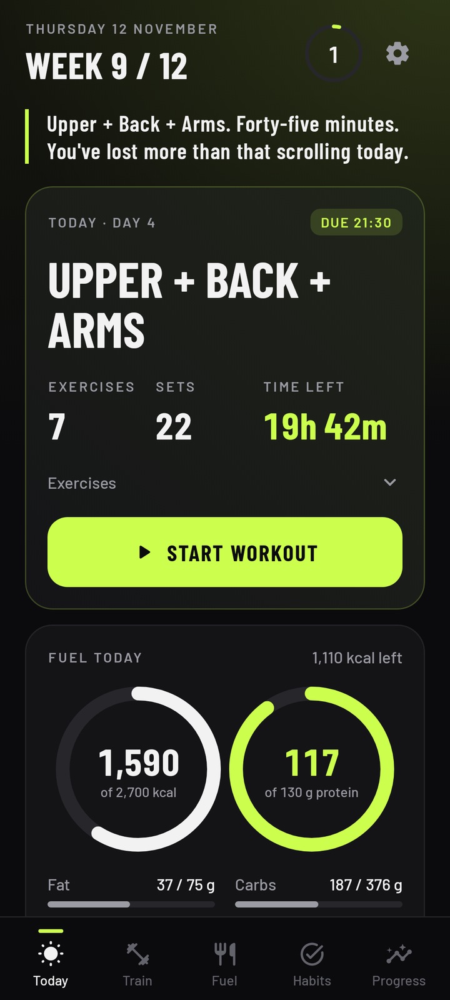
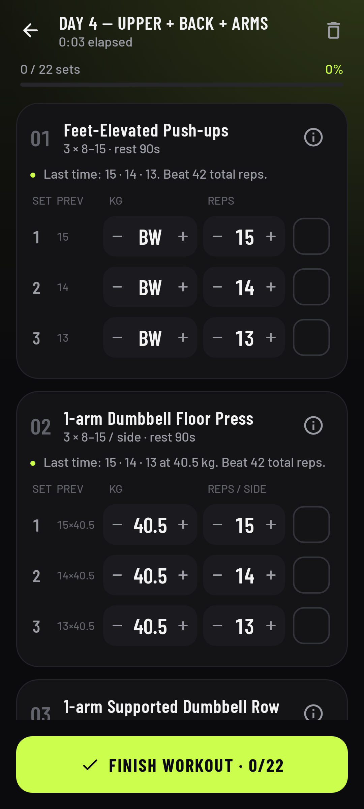
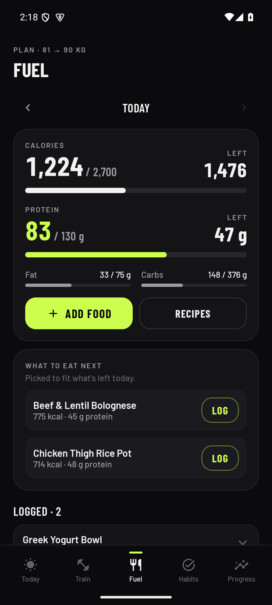
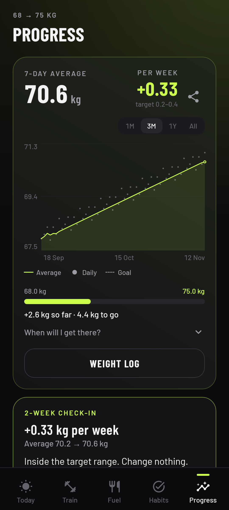
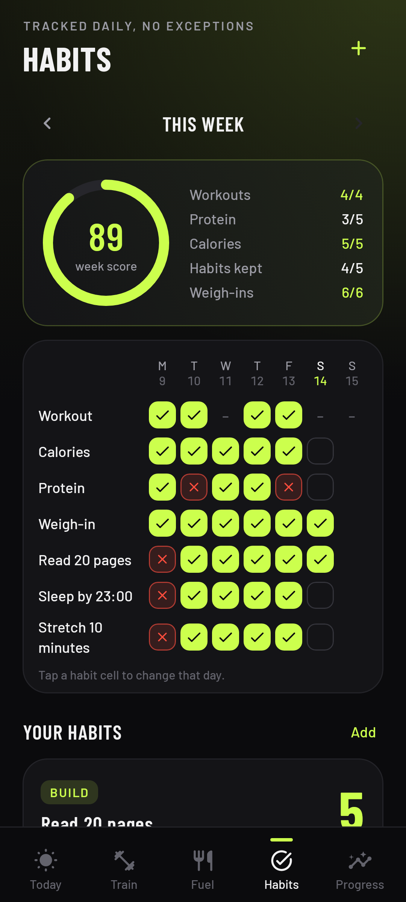
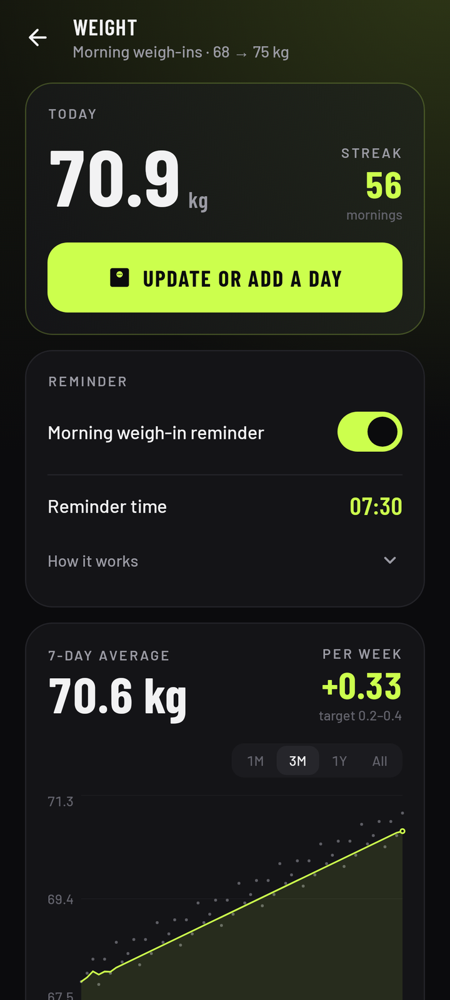
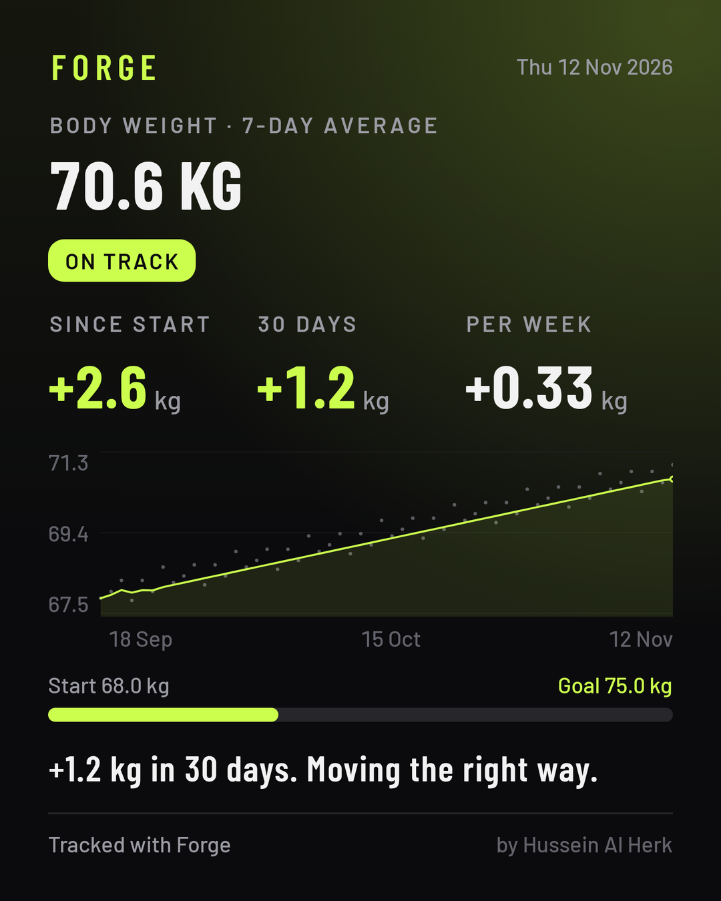
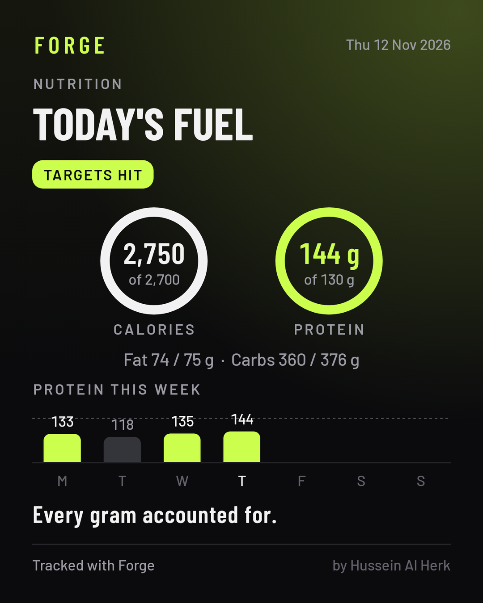
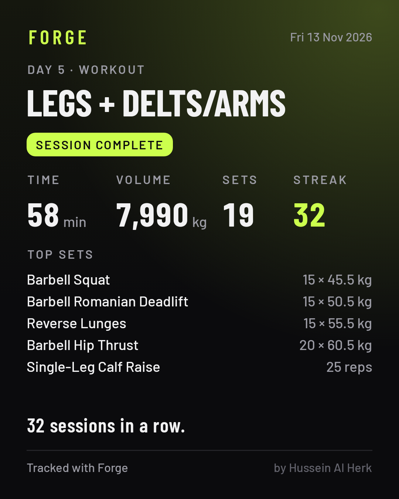

# Forge

**Designed and developed by Hussein Al Herk.**

A training and nutrition app for Android that holds you to your plan: reminders, deadlines, and real consequences for skipping.

It ships with a 4-day home muscle program and a lean-bulk nutrition plan, logs every set, tracks calories, protein and morning weight, finds food values online or from a photo of the label, and tracks the daily habits you choose. Everything stays on your phone.

<p>
  
  
  
  
  
  
</p>

Share your progress, a day of eating or a workout as a ready-to-post image:

<p>
  
  
  
</p>

## Install

1. Download `Forge-x.y.z.apk` from the [latest release](../../releases/latest) on your phone.
2. Open it and allow installs from your browser or file manager when Android asks.
3. After that the app updates itself: **Settings → Updates**, or the daily "new version" notification. Updates install over the existing app, so your data stays.

Prefer a dedicated updater? [Obtainium](https://github.com/ImranR98/Obtainium) works with this repo too.

## What it does

| | |
|---|---|
| **Today** | Today's session with a live deadline countdown, calorie and protein rings, morning weigh-in, daily habit check-in, streak, week score, and a blunt line for the day. |
| **Train** | The program, form guides for every exercise (how to do it, setup, cues, common mistakes) in tap-to-open sections, a 1-rep-max chart per exercise, session history. |
| **Workout** | Tick sets, adjust reps and kg, see last time's numbers, automatic rest timer, double-progression hints ("go heavier: 12.5 kg"), PR detection. A session counts only at 75% of its sets. |
| **Fuel** | Calories and macros against your targets. Search a basic food list (USDA), 35 Syrian dishes with sourced values, and packaged foods online (Open Food Facts). Scan a barcode, or photograph a nutrition table and name the food. 15 budget high-protein recipes, full-day meal plans. A weekly chart of protein or calories with your daily average and hit count. |
| **Habits** | Add any habit you want to build or quit. Weekly grid, week score, streaks and best runs, the last 4 weeks of each habit at a glance, an urge timer for quit habits, penalty record. Starts empty. |
| **Progress** | 7-day average weight with a 1M / 3M / 1Y / All chart, kg per week vs target, ETA, 2-week check-in, workouts and training volume for the last 8 weeks, levels, lifts, progress photos (stored privately) and body measurements. |
| **Weight** | Morning weigh-ins with a type-in reminder notification, streak, 30-day change, lowest and highest, weekly averages, editable history. |
| **Share** | A share button on Progress, Fuel and every workout turns it into a 1440 × 1800 image with your numbers and a chart, ready for Instagram or WhatsApp. Cards earn a badge when you hit your targets, stay on track or set a personal record. |

### Consequences

- Miss the daily deadline on a training day: the streak resets, you lose XP, and a random penalty lands (e.g. 100 push-ups) that's due in 24 hours.
- Ignore the penalty and it doubles. Ignore it again and it's recorded as failed.
- Make the session up within 48 hours to restore the streak. The penalty still stands.
- Actually sick? Tap **I'm sick today** (or mark yesterday) to skip with no penalty and no XP lost. The streak pauses instead of resetting. Up to 3 sick days in any 30.
- Optional penalty jar: a money amount you owe yourself for every miss or slip.

## Your data

- Stored only on the device. No account, no analytics.
- Network calls: this repo (new releases, and the latest dish list) and [Open Food Facts](https://world.openfoodfacts.org) (what you type into food search, or a barcode you scan). Nothing else is sent.
- Nutrition labels are read on the phone. Photos are never uploaded or saved.
- Updates keep your data: same app, same signing key. The updater refuses any APK signed with a different key.
- A backup is written before every update, and daily to `Downloads/Forge/` on Android 10+. **Settings → Data** exports, imports and restores.

## The built-in plan

The program (Day 1 Chest Priority, Day 2 Legs + Posterior Chain, rest, Day 4 Upper + Back + Arms, Day 5 Legs + Delts/Arms, rest, rest) is used exactly as written. Nutrition targets default to 2,700 kcal and 130 g protein, and you set your own during setup or in Settings.

**Not medical advice.** If you have a medical condition, check calorie and protein limits with your clinician.

## Syrian dishes

Food search includes 35 Syrian and Levantine dishes in English and Arabic: shish barak, kibbeh bil sayniyeh, yabraq, mloukhieh, fatteh, mujaddara and more. Every value has a source shown in the app, and nothing is estimated:

- 30 dishes measured in an accredited lab: Hoteit et al., [*F1000Research* 10:12 (2021)](https://doi.org/10.12688/f1000research.27461.1).
- Manakish, Arabic bread and halawa from the [FAO/USDA Food Composition Tables for the Near East](https://www.fao.org/4/x6879e/x6879e00.htm).
- Baklava from [USDA FoodData Central](https://fdc.nal.usda.gov/food-details/2708044/nutrients).

The list lives in [`app/src/main/assets/dishes.json`](app/src/main/assets/dishes.json), and the app downloads the newest copy from this repo, so a dish can be added without a new release. To add one, give its values per 100 g with a published source, and bump `version`. Fried kibbeh, maqluba and muhammara aren't in yet: no measured values for them turned up. Corrections and sources are welcome.

## Build

JDK 17 and the Android SDK (platform 35).

```bash
./gradlew testDebugUnitTest assembleDebug
```

Releases are built and signed by GitHub Actions when a `v*` tag is pushed, or from **Actions → Release → Run workflow**. See [RELEASING.md](RELEASING.md). Contributions: [CONTRIBUTING.md](CONTRIBUTING.md).

## About the developer

Forge is designed, built and maintained by **Hussein Al Herk**.

- Portfolio: [kiraherk.github.io](https://kiraherk.github.io)
- LinkedIn: [husseinalherk](https://www.linkedin.com/in/husseinalherk)
- GitHub: [@KIRAHERK](https://github.com/KIRAHERK)

## Credits

Exercise cues compiled from ACE, NASM, Motra, Garage Gym Reviews, Muscle & Strength, Eric Cressey and StrengthLog. Food values from USDA FoodData Central, Hoteit et al. (2021) and the FAO Near East tables. Product data from Open Food Facts (ODbL). Scanning uses Google ML Kit, on device. Typeface: Barlow (SIL Open Font License).

## License

Source-available under the [PolyForm Noncommercial License 1.0.0](LICENSE). Copyright (c) 2026 Hussein Al Herk.

- **Free for personal use.** Download it, use it, read the code, change it for yourself.
- **Commercial use needs a license.** Selling Forge, rebranding it, or running it for a gym, coaching business or any other company requires a commercial license. Gyms and coaches who want Forge with their own brand and programs: get in touch via [LinkedIn](https://www.linkedin.com/in/husseinalherk) or [kiraherk.github.io](https://kiraherk.github.io).

Versions up to and including 1.7.0 were released under the MIT license and stay under it.
